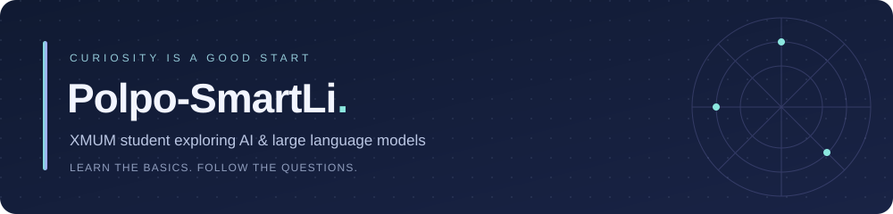

**XMUM Student · AI & LLM Enthusiast · Still Learning**

从基础出发，慢慢走向大语言模型。

[About me](#about-me) · [Interests](#what-i-want-to-explore) · [Learning](#one-step-at-a-time)

 

## About me

Hi, I'm **Polpo-SmartLi**, a student at **Xiamen University Malaysia (XMUM)**.

我对人工智能充满好奇，希望未来能深入 **大语言模型（LLMs）** 方向。目前还在打基础：比起给自己贴上很多技术标签，我更希望先把概念理解清楚，再一点点动手尝试。

- 🎓 **身份**：XMUM 学生
- 🧭 **方向**：Artificial Intelligence → Large Language Models
- 🌱 **状态**：在学习，也在寻找自己真正感兴趣的问题
- 💭 **想法**：允许自己从初学者开始，把每一点进步积累起来

 

## What I want to explore

| 方向 | 我想弄明白的问题 |
| :--- | :--- |
| **AI foundations** | 模型是怎样从数据中学习的？ |
| **Natural language processing** | 计算机如何表示和处理语言？ |
| **Large language models** | 大语言模型如何生成回答，又为什么会出错？ |
| **Learning by doing** | 能不能用一个小实验，检验自己的理解？ |

 

## One step at a time

接下来，希望沿着这条路线慢慢深入：

**编程与数学基础** → **机器学习与深度学习** → **NLP 与 Transformer** → **LLMs**

不急着把所有工具都学一遍。先读懂一个概念、跑通一个例子，再尝试解释清楚它为什么有效。

---

**Learning in public. Growing at my own pace.**

慢慢学，认真想，保持好奇。

